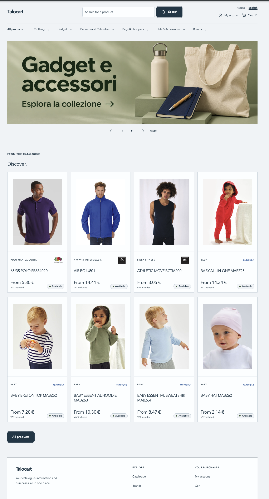
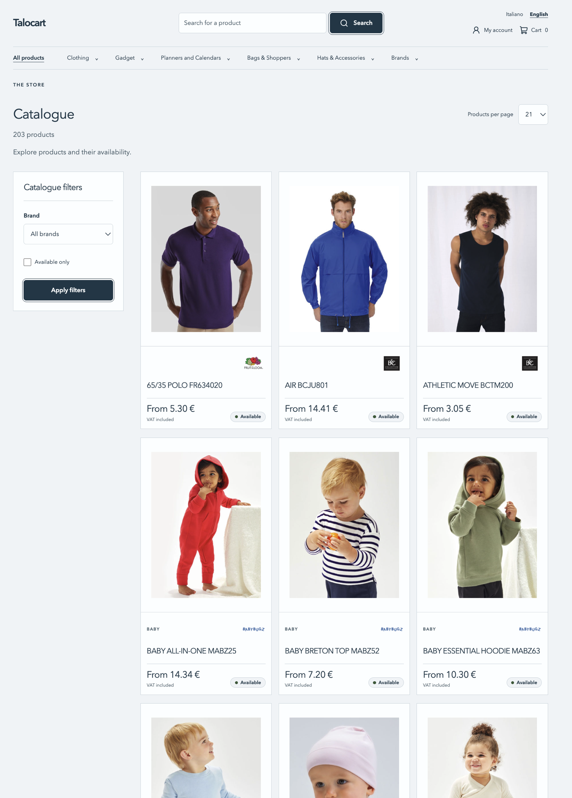
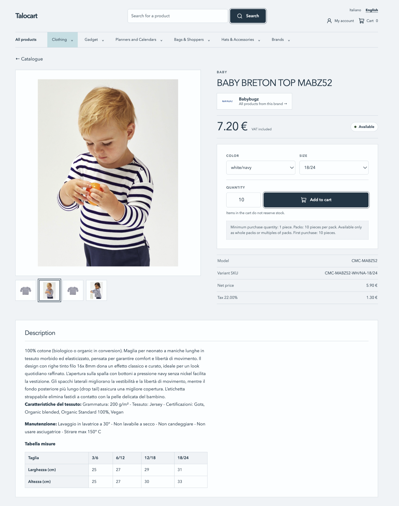
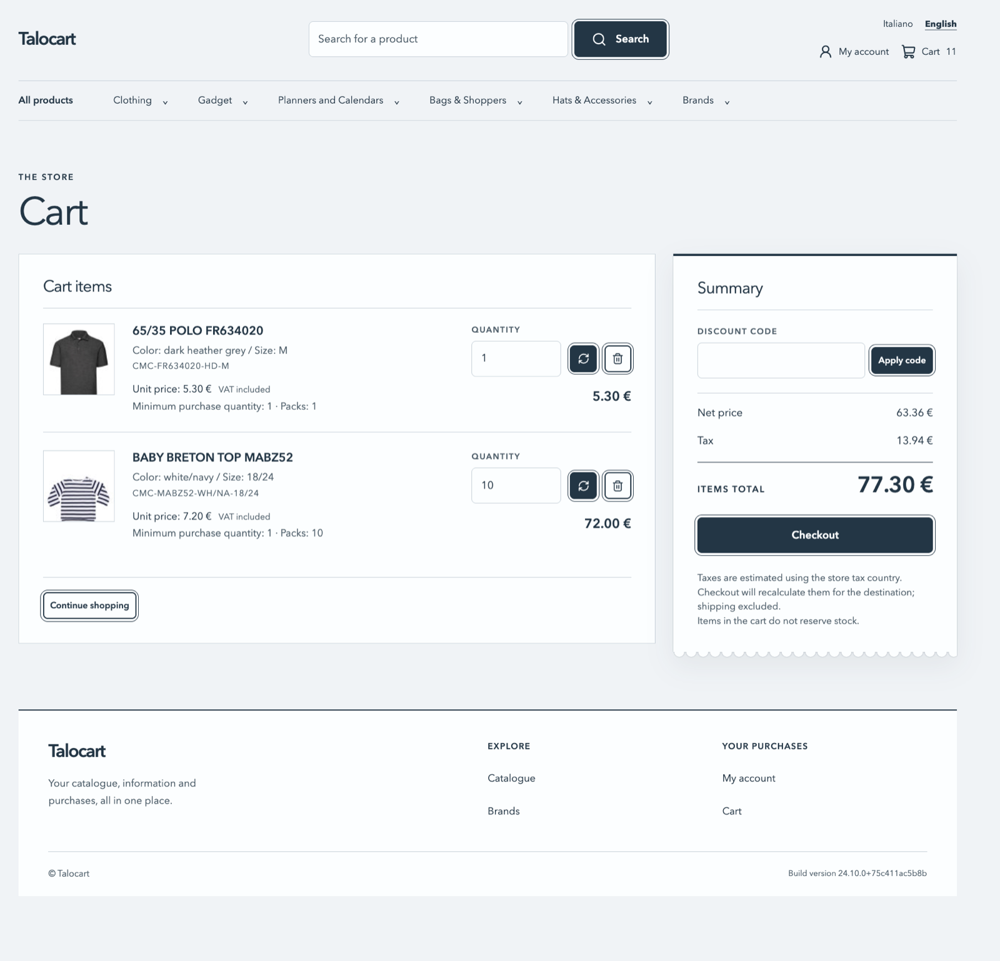
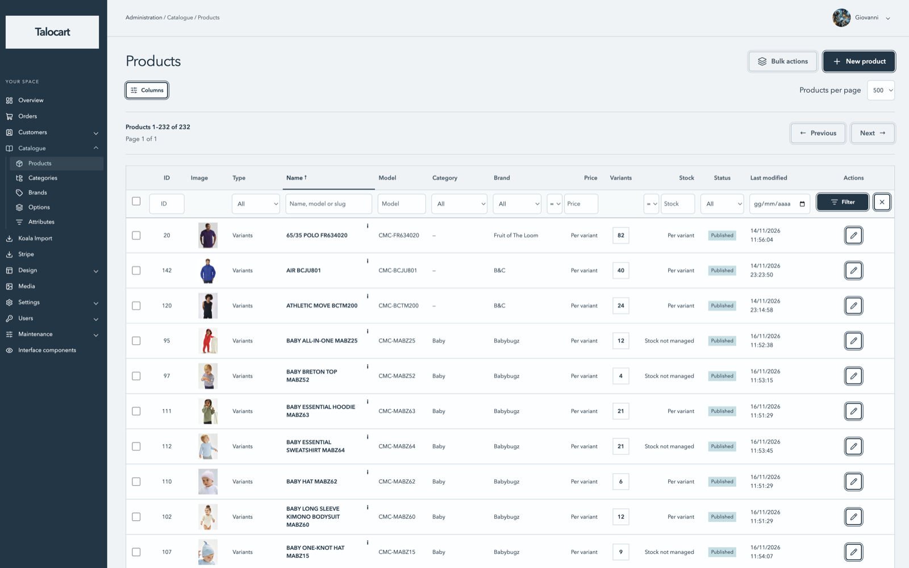
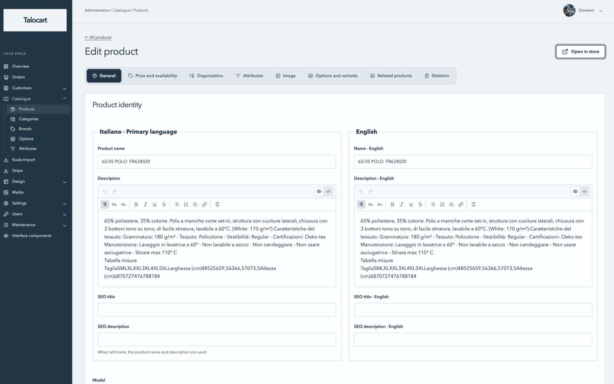
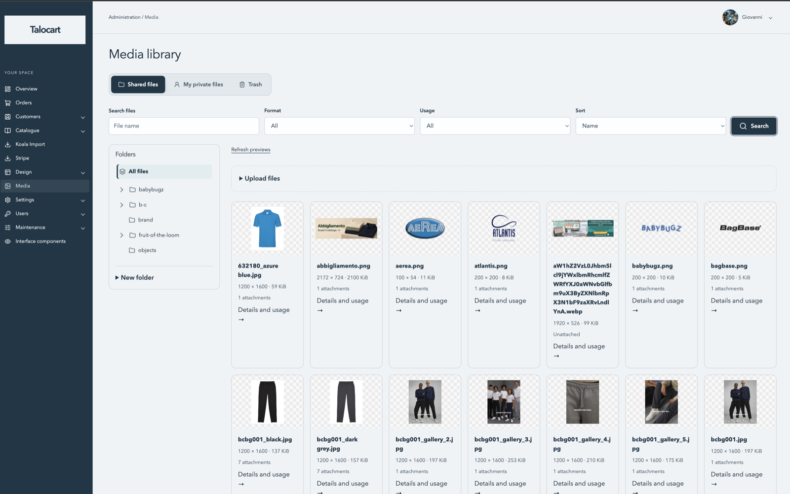

# Talocart — self-hosted Rust e-commerce

Talocart is an open-source, self-hosted e-commerce application written in Rust.
It includes an online storefront and an admin dashboard for product catalogs,
shopping carts, checkout, customers, inventory and order management.

The modular monolith uses PostgreSQL, Axum, Askama and HTMX for server-side
rendering and progressive enhancement. The interface supports English and
Italian, two compiled themes and native HTML forms. Templates, assets and
migrations are embedded in the application executable.

**Status: development beta.** This repository contains the MIT-licensed base
only. It supports bank transfer, cash on delivery and manual payment recording.
Optional payment providers and import adapters are distributed separately; their
implementations, assets and tests are not included here. The base retains the
extension interfaces needed to develop and install trusted native packages.

**Versioning:** The public base continues Talocart’s existing version sequence; 24.x does not indicate a stable or production-ready release.

Publishing these sources does not qualify a release for production. Review the
[open work](IMPLEMENTATION_PLAN.md) and [operational checklist](docs/operational-readiness-checklist.md)
before using Talocart with real customers. Storefront search-engine indexing is
disabled by default and can be enabled in the store settings. The listener binds
to loopback and requires an HTTPS reverse proxy for public access.

Start with the [quick start](#quick-start), browse the
[documentation](docs/README.md), read the [changelog](CHANGELOG.md), or use the
[contributing guide](CONTRIBUTING.md) for reports and pull requests.

## Screenshots

A look at a local installation with a populated catalog. Click any screenshot
for the full-size view. The Koala Import and Stripe navigation entries visible
in the admin screenshots belong to optional modules, not included in this base
repository.

**Storefront — promotional banners and featured products.**

[](docs/screenshots/storefront.png)

| Catalog | Product details |
| --- | --- |
| [](docs/screenshots/catalog.png) | [](docs/screenshots/product.png) |

| Shopping cart | Product administration |
| --- | --- |
| [](docs/screenshots/cart.png) | [](docs/screenshots/admin-products.png) |

| Product editor | Media library |
| --- | --- |
| [](docs/screenshots/admin-edit-product.png) | [](docs/screenshots/media-library.png) |

## Features

| Area | Included in the base |
| --- | --- |
| Catalog | Simple products, variants, SKU/model, nested categories, brands, options, attributes, galleries, related products, optional stock control, minimum quantities and packs |
| Storefront | Search, filters, pagination, category/brand pages, banners, information pages, metadata and sitemap |
| Presentation | Original and Essential themes, configurable palette, local fonts and density; responsive EN/IT interface |
| Content | Explicit translations, primary-language fallback, Visual/HTML editing and server-side sanitization |
| Customers | Configurable guest checkout, accounts, optional email confirmation, profiles, default/saved addresses, tax details, persistent carts and order history |
| Commerce | Integer amounts, inclusive/exclusive tax entry, tax classes/zones, currency, coupons and group quantity discounts |
| Checkout | Server-authoritative prices, availability, shipping, payment selection and order confirmation |
| Orders | Administrative drafts and audited revisions, immutable purchase snapshots, numbering, atomic stock changes, idempotency, cancellation, fulfillment, tracking and internal notes |
| Media | Private shared library, folders, trash, responsive image copies and background maintenance |
| Administration | Owner, administrators, roles/permissions, settings, operation history and private error logs |
| Extensions | Separately installed native packages with shared Rust SDK, process supervision and explicit protocol/database compatibility checks |

Multi-store, marketplaces, electronic invoicing, subscriptions, returns and
partial shipments/refunds are outside the current scope. Order receipts do not
replace legally required invoices or other fiscal documents.

## Requirements

- The Rust toolchain pinned in [rust-toolchain.toml](rust-toolchain.toml) and
  native build tools to compile from source.
- PostgreSQL 17 and persistent writable private storage for configuration,
  media, package state and logs.
- Node.js 22+ and Playwright/Chrome for asset development and browser tests.
  Neither Node nor Rust is required to run a precompiled executable.
- Python 3.11+ and PostgreSQL 17 client tools for backup and restore.

Linux distribution targets are x86_64 and arm64 with glibc 2.36 or later.
Templates, assets, translations, demo content and migrations are embedded in
the executable. PostgreSQL remains a separate service.

The current development schema baseline requires a fresh installation. An older
baseline may have incompatible migration checksums; do not reset an existing
database or rewrite its migration ledger. See the
[schema contract](docs/architecture.md#data-transactions-and-errors) before upgrades.

## Quick start

Clone the standalone base repository:

```sh
git clone https://github.com/giovanni72/talocart.git
cd talocart
```

### Try with Docker Compose

With Docker and Compose installed, run from this standalone checkout:

```sh
docker compose up --build -d
```

Open [local setup](http://127.0.0.1:3300/setup), create your administrator and
optionally select **Install demo data**. This runs only the base and PostgreSQL,
with persistent demo volumes and no default administrator password.
The first run compiles Rust and can take several minutes; later starts reuse the
image. See the [Docker demo guide](docs/guides/docker-demo.md) for readiness,
shutdown, reset and limitations.

### Run from source

Prepare a dedicated PostgreSQL database owned by the application role; the
[local guide](docs/guides/local-development.md) describes the setup.

```sh
cp talocart.example.toml talocart.toml
chmod 600 talocart.toml
```

Add `url` under `[database]` in the private file using your own connection
settings. Keep the listener on loopback. Do not commit this file or credentials.

```sh
cargo build --locked -p talocart
./target/debug/talocart --config talocart.toml migrate
./target/debug/talocart --config talocart.toml doctor
./target/debug/talocart --config talocart.toml serve
```

Open [local setup](http://127.0.0.1:3000/setup), choose the store languages and
create the owner. Demo content is optional. There are no default credentials;
setup closes after completion. Then open [administration](http://127.0.0.1:3000/admin).

For subsequent starts use `doctor` and `serve`. Apply migrations explicitly
when an upgrade requires them: **doctor, serve and readiness never migrate**.
Configuration changes require restart; embedded source changes require rebuild.

Before testing a purchase, publish a product with valid stock/tax settings,
enable purchasing countries and compatible shipping and payment methods.
Configure SMTP, sender and recipients in Settings → Email for notifications.
No purchasing countries are enabled initially. See [commerce](docs/guides/commerce.md).

## Configuration

[talocart.example.toml](talocart.example.toml) lists the infrastructure settings.
Supported `TALOCART_*` environment variables override the file; `.env` is not
loaded automatically. Unknown TOML fields are rejected. Relative paths are
resolved against the configuration file's directory.

SMTP is configured in the administration, not in TOML. Its encryption key is
stored separately beside the media root and must be included in recovery.
Never expose media, packages, logs, configuration or secret directories directly
through the web server. See [operations](docs/release-operations.md).

## Development and verification

Read the [contribution guide](CONTRIBUTING.md), [development rules](AGENTS.md)
and [test policy](docs/testing-policy.md). Select checks by impact, using synthetic
data and dedicated resources. The runner does not build the application.

```sh
python3 scripts/test-run.py --list
python3 scripts/test-run.py --only rich-text --only postgres-pages --dry-run
npm ci --ignore-scripts --no-audit --no-fund
npx playwright install chromium
python3 scripts/test-env.py up
cargo build --locked -p talocart
python3 scripts/test-env.py run -- python3 scripts/test-run.py --only rich-text --only postgres-pages
```

Build the debug application before browser verification when embedded inputs
change. Test reports are private local files under `.local/test-runs/`.
Human visual review is also required for visible changes. A configured CI job
is not evidence that the job has run.

## Project structure

| Path | Responsibility |
| --- | --- |
| `apps/talocart` | CLI, composition, configuration and worker supervision |
| `crates/platform` | Persistence, identity, media, email and extension infrastructure |
| `crates/commerce` | Catalog, pricing, checkout, orders and commercial content |
| `crates/web` | HTTP, localization, typed view models, templates and assets |
| `crates/module-sdk` | Shared runtime for independently built native extensions |
| `crates/package-fixture` | Synthetic executables for extension contract tests |
| `themes/default`, `themes/essential` | Compiled presentation themes |

See the [documentation index](docs/README.md), [architecture](docs/architecture.md),
[extension guide](docs/developer-modules-and-themes.md) and [security policy](SECURITY.md).

## License

The base is licensed under [MIT](LICENSE). Retain bundled third-party notices.
External packages have their own licenses and are not included in this repository.
Run the documented commands from the repository root. The source distribution
includes its own Cargo manifest and lockfile.
